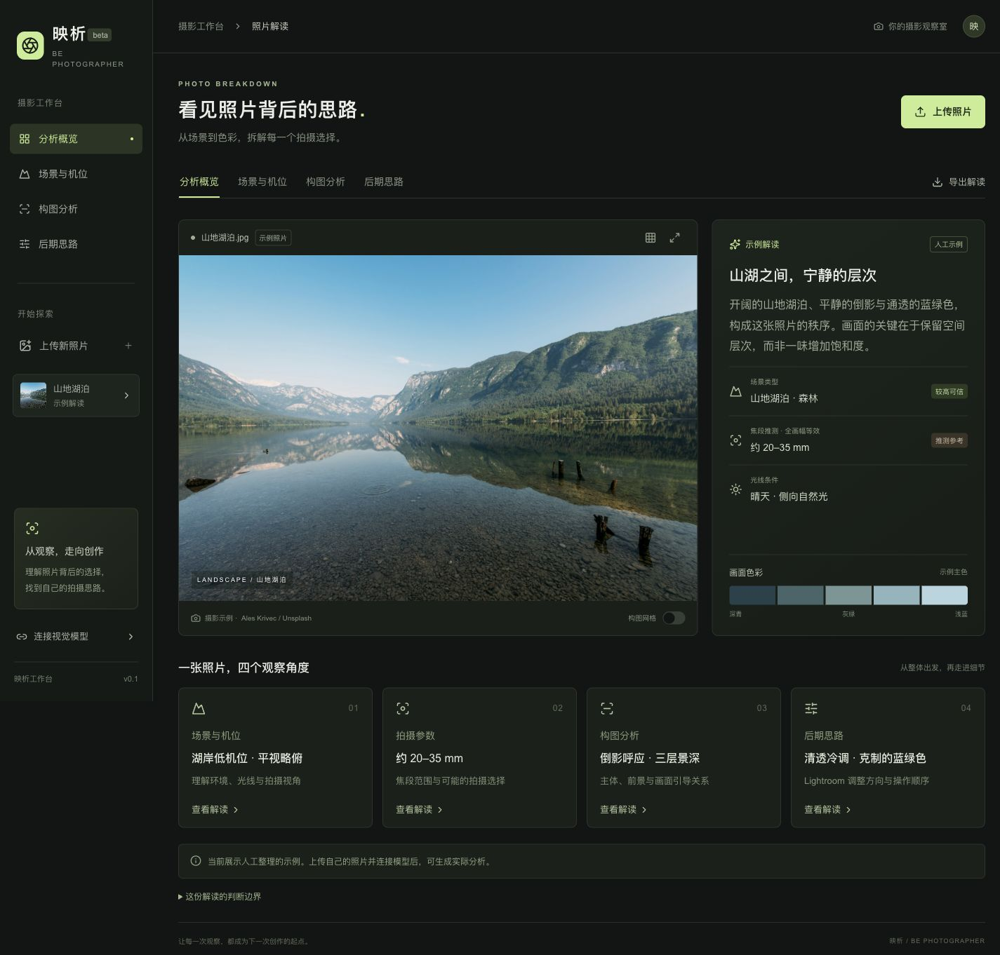

# 映析 · Be Photographer

从一张摄影作品，理解场景、机位、焦段、构图与 Lightroom 调色思路。

**作者：[Qinghui Xing (@xingqh)](https://github.com/xingqh)** · **软件许可证：[MIT](LICENSE)**



## 功能

- 上传或拖入 JPG / PNG / WebP，最大 20 MB，支持电脑和手机。
- 本地读取 JPEG EXIF：相机、镜头、实际焦距、35mm 等效焦距、光圈、快门和 ISO；不读取或上传 GPS。
- 本地计算主色和亮度直方图，无需模型密钥。
- 分析场景类型、粗略地域、光线和拍摄机位，提供画面依据及定性可信程度。
- 估计焦段范围；有 EXIF 时优先使用文件记录。
- 解读主体、前中后景、引导线、留白和平衡，支持三分法参考网格及全屏查看。
- 提供 Lightroom 参数的调整方向、粗略幅度、操作顺序和理由。
- 导出中文 Markdown 解读，保留信息来源和判断边界。
- 支持 **DeepSeek Flash** 与 **OpenAI GPT-4.1 mini**；示例解读无需密钥。

## 快速开始

需要 **Node.js 22.13+**（推荐 Node.js 24）和 npm。

```sh
git clone https://github.com/xingqh/be-photographer.git
cd be-photographer
npm run install:ci
npm run dev
```

打开 http://localhost:5173 。本地运行不需要 Sites 账号，也不需要配置环境变量。

1. 点击“连接视觉模型”，选择 DeepSeek Flash 或 OpenAI。
2. 输入对应服务的 API Key，点击“保存连接”。
3. 上传摄影作品，再点击“分析照片”。
4. 在“场景与机位”“构图分析”“后期思路”中查看结果，或导出解读。

密钥仅保留在当前页面内存中；刷新页面或切换模型服务会清除密钥。模型调用费用由密钥所属账号承担。没有密钥时，可以使用人工示例、照片预览、EXIF、像素统计和参考网格。

## 实现原理

```text
照片 → 浏览器读取 EXIF、提取色彩、压缩图片
     → 图片 + EXIF + 摄影分析提示词 + JSON Schema
     → 服务端调用选定的多模态模型
     → 校验返回结构、优先应用 EXIF 文件记录
     → 场景 / 机位 / 参数 / 构图 / 调色报告
```

当前版本使用固定摄影提示词和现成的多模态模型，没有训练专门的摄影反推模型。一次请求生成完整报告。提示词要求模型区分观察、推测和无法判断，并给出画面依据。

- `lib/photo.ts`：EXIF 解析、最长边 1600 像素的 JPEG 压缩、色彩取样、亮度直方图和 EXIF 优先规则。
- `lib/vision.ts`：摄影分析提示词、JSON Schema 和模型响应解析。
- `lib/providers.ts`：模型服务白名单与超时配置。
- `app/api/analyze/route.ts`：请求校验、模型调用、持续状态响应和错误处理。
- `lib/analysis-client.ts`：浏览器响应解析。
- `app/page.tsx`：照片上传、模型配置和分析工作台。
- `tests/analysis.test.ts`：EXIF、服务路由、输出校验、超时及取消等测试。

技术栈：React 19、TypeScript、Vinext / Vite、Tailwind CSS 4、Radix UI、Zod。构建目标为 Cloudflare Workers，保留了可选的 Sites 集成代码；`.openai/hosting.json` 仅包含空资源绑定，不含作者私人部署的项目 ID。

## 数据处理与连接

照片先在浏览器处理。只有点击分析后，压缩照片和选定的 EXIF 字段才经本应用后端发送到所选模型服务。代码不持久化照片、解读或密钥；模型请求使用 `store: false`，服务商自身的数据处理政策仍适用。

API 地址固定在服务端，不根据密钥前缀猜测服务商。DeepSeek 使用 `deepseek-flash`，关闭默认深度思考以减少等待；OpenAI 使用 `gpt-4.1-mini`。请使用模型服务当前有效且具有图像访问权限的密钥。

分析期间每 15 秒发送状态，后台总等待上限两分钟，页面额外保留 10 秒网络传输时间。取消或替换照片会中止请求。超时、密钥错误、余额不足、限流和异常响应分别提示，失败时保留当前照片，不自动重复请求。

浏览器支持 WebMCP 时，提供 `read_photo_analysis` 和 `select_analysis_view`，用于读取当前报告或切换视图，不调用模型、不发送照片。

## 判断边界

- EXIF 是可被编辑的文件记录，不是事实认证。
- 缺少 EXIF 时，焦段只能尝试估计全画幅等效范围。裁切、拼接和传感器尺寸会影响判断。
- 光圈、快门和 ISO 通常无法仅凭成片可靠反推；缺少记录时，结果属于复现建议。
- 地点以森林、高山、峡谷、冰川、海岸等粗略类型为主，无法保证识别真实拍摄地。
- Lightroom 建议用于复现相近观感，不能还原原作者的 RAW 编辑历史；试调范围需要结合自己的原片。
- 可信程度由模型定性给出，尚未通过样片评测校准。格式校验只检查结构，不能保证摄影判断正确。

RAW / HEIC、视频和批量分析暂不支持。PNG / WebP 可分析，但当前只解析 JPEG EXIF。默认山地湖泊报告是人工示例，与上传照片的真实模型分析明确区分。

## 测试与构建

```sh
npm test
npm run typecheck
npm run build
```

构建产物位于 `dist/`。可使用 `npm start` 在本机运行构建后的 Worker；地址以启动输出为准。发布到自己的 Cloudflare Workers 时，需要使用自己的账号及部署配置。

自动测试覆盖 16 项，使用模拟模型响应，不需要真实 API Key，也不产生模型费用。真实分析质量需要有效密钥和代表性摄影作品进行验证。

## 后续方向

批量照片与对比、RAW / HEIC 支持、摄影类型适配、样片评测、更多视觉模型、Lightroom 配方收藏与原片调色对照。

## 作者与许可

项目作者：**Qinghui Xing (@xingqh)**。

项目软件采用 [MIT License](LICENSE)。第三方代码、依赖和示例图片保留各自许可，详见 [THIRD_PARTY_NOTICES.md](THIRD_PARTY_NOTICES.md)。示例照片为 [Ales Krivec / Unsplash](https://unsplash.com/photos/8aSs7QejvSw)，适用 [Unsplash License](https://unsplash.com/license)，不属于项目软件的 MIT 授权。
